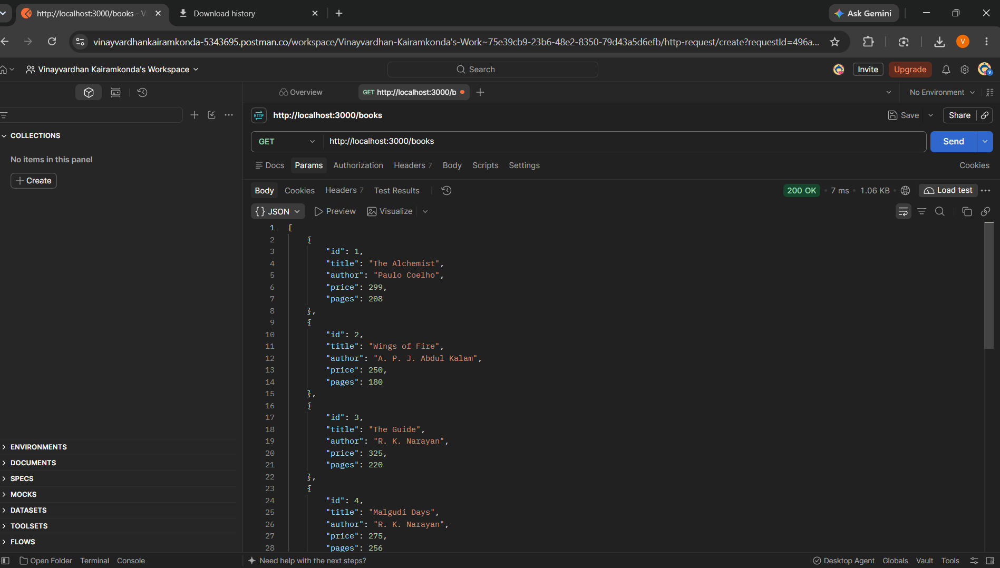
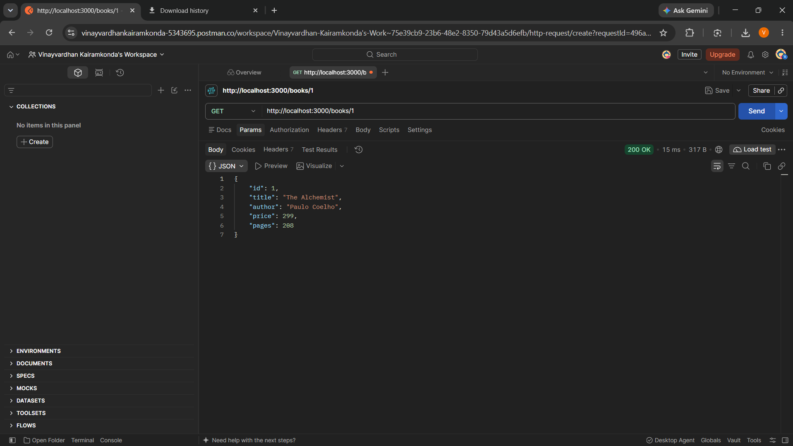
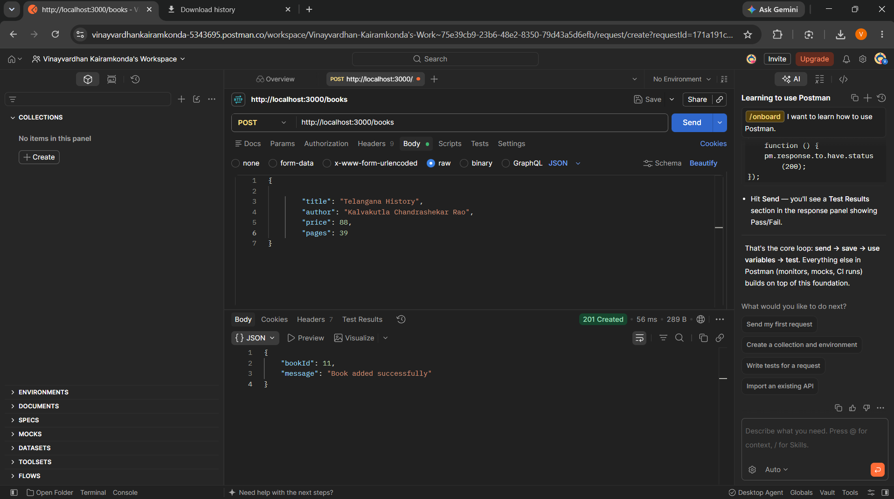
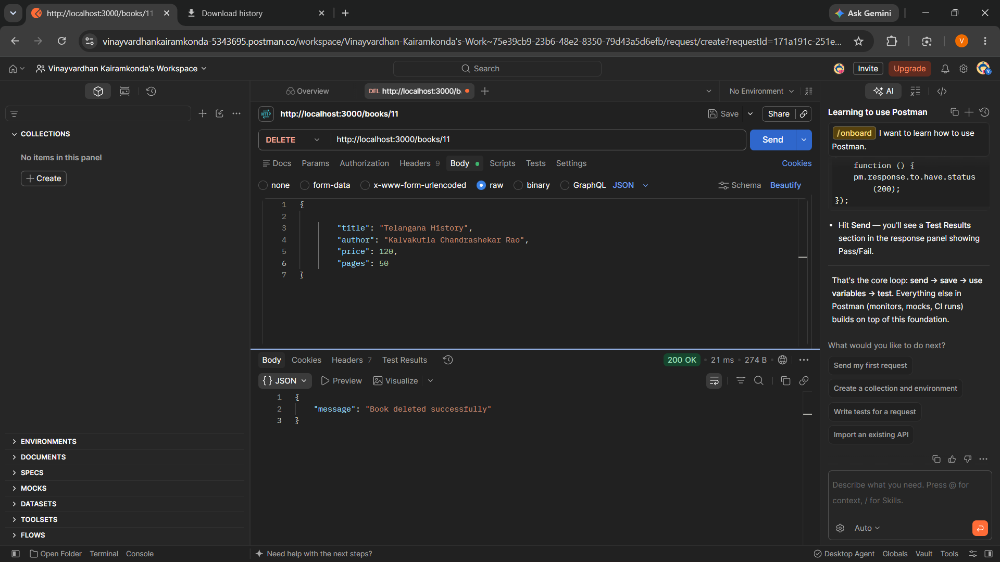
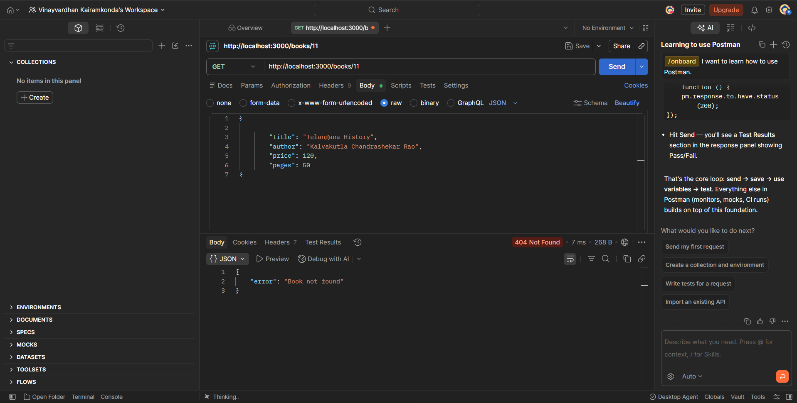
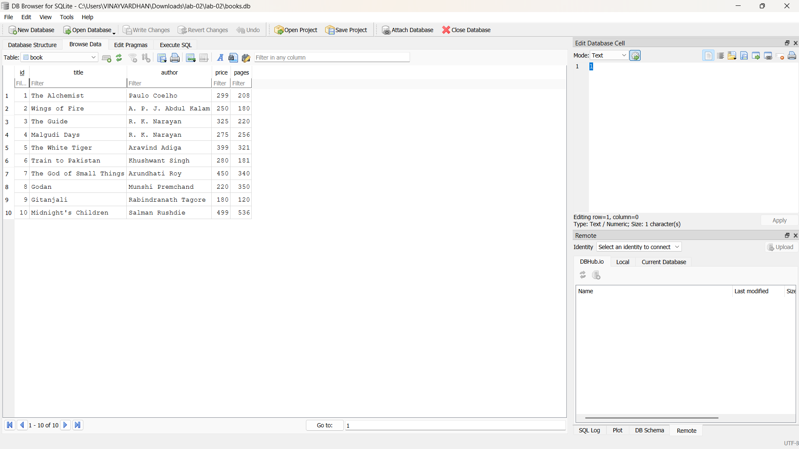

# Lab 2: SQLite database and CRUD routes

**Name:**  Kairamkonda Vinay Vardhan · **Registration number:** <252U1R9052> · **Section:** CSE-GenAI-2A-304

**Live link:** <paste your deployed URL here, or explain why the project could not be deployed>

## How to run

```bash
npm install            # installs express, sqlite, sqlite3 and nodemon
npm run dev            # start with nodemon (restarts on every change)
# or
npm start              # plain node
```

Environment variables (see `.env.example`; never commit your real `.env`):

| Variable | Description | Default |
| --- | --- | --- |
| `PORT` | Port the server listens on | `3000` |

The database file `books.db` is included. To recreate it from scratch:

```bash
rm books.db && sqlite3 books.db < schema.sql
```

## Endpoints

| Method | Path | Description | Success status |
| --- | --- | --- | --- |
| GET | `/books/` | Get all books | 200 |
| GET | `/books/:bookId/` | Get one book by id | 200 (404 if not found) |
| POST | `/books/` | Add a new book | 201 |
| PUT | `/books/:bookId/` | Update an existing book | 200 (404 if not found) |
| DELETE | `/books/:bookId/` | Delete a book | 200 (404 if not found) |

Invalid ids or bodies return `400` with `{ "error": "..." }`. Request body for POST/PUT:

```json
{ "title": "Book title", "author": "Author name", "price": 300, "pages": 250 }
```

## Screenshots









## Notes

<Problems faced and how you solved them.>
