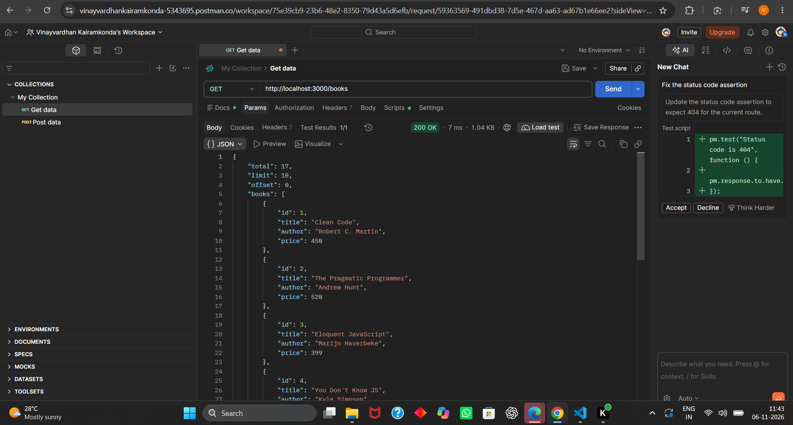
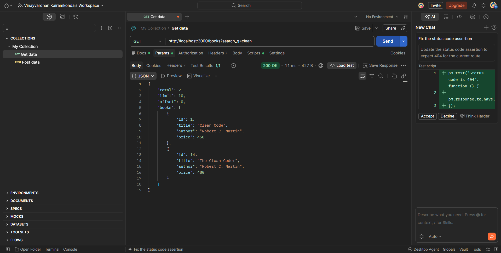
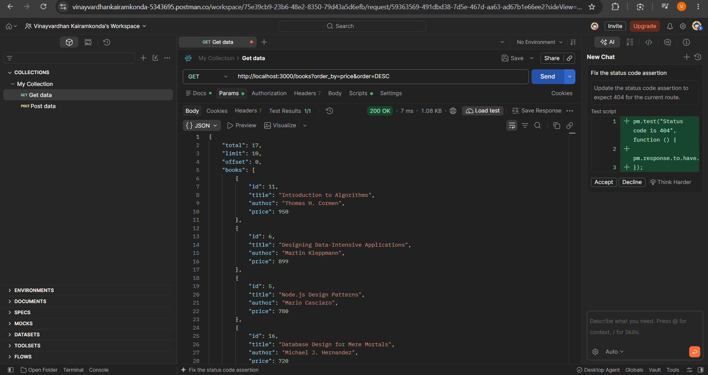
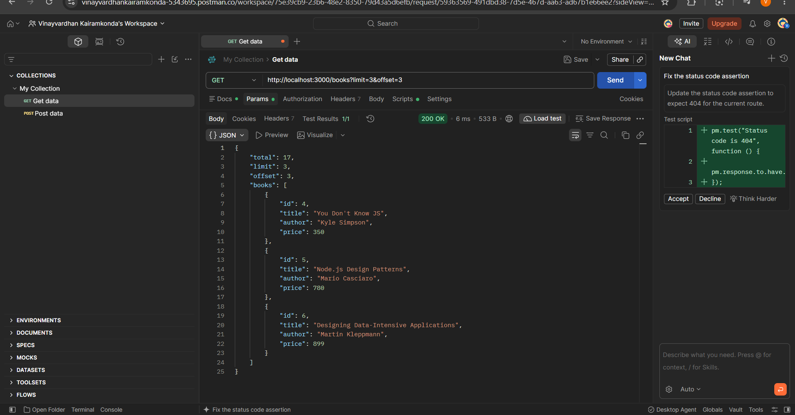
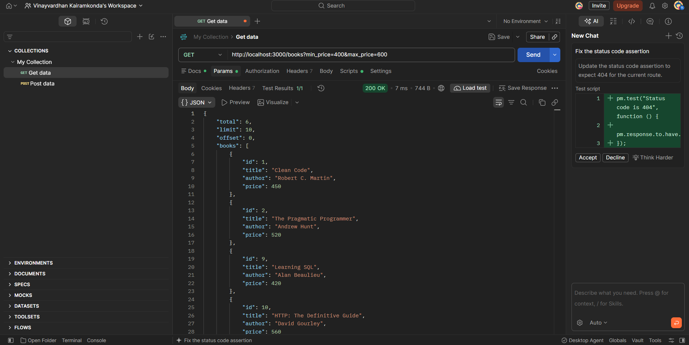
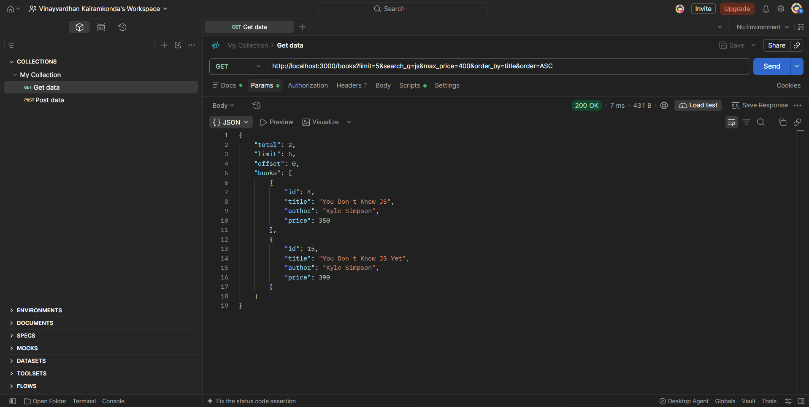
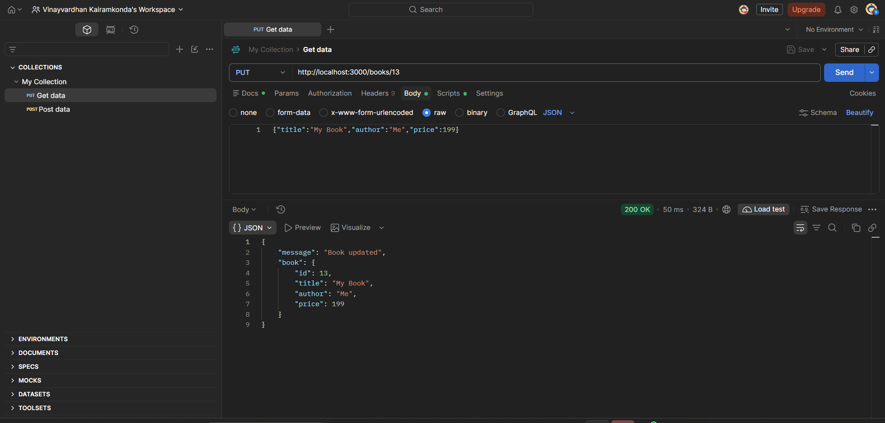
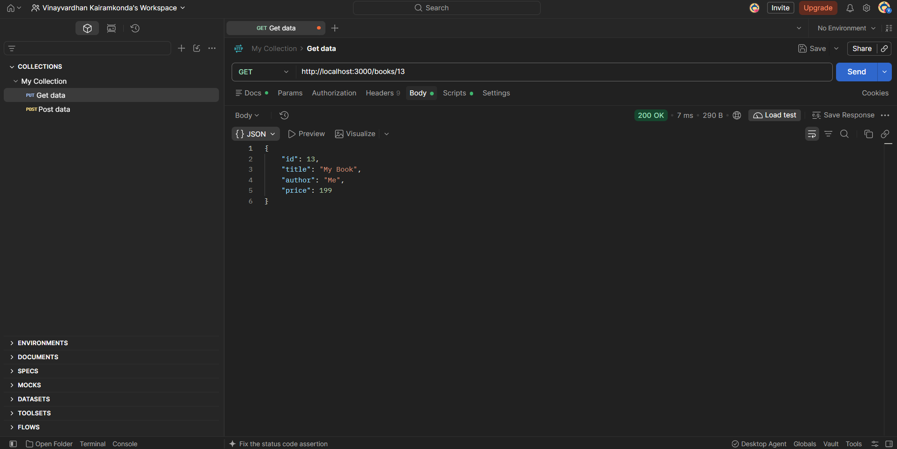
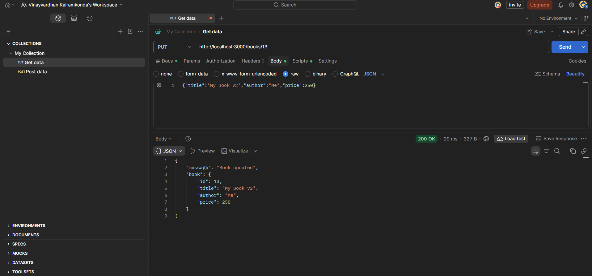
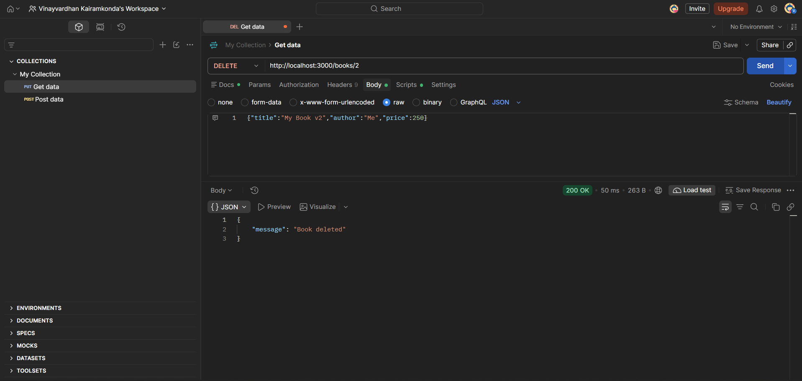

# Lab 3: REST API, query parameters, validation, debugging

**Name:** Kairamkonda Vinay Vardhan · **Registration number:** 252U1R9052 · **Section:** CS(GEN-AI)2A & 304

**Live link:** https://labs-llvj.vercel.app/books

## How to run

Requires Node.js 18 or newer.

```bash
cd lab-03
npm install
cp .env.example .env     # then edit values if needed
npm start
```

Environment variables (see `.env.example`; never commit the real `.env`):

| Variable | Meaning | Default |
| --- | --- | --- |
| `PORT` | Port the server listens on | `3000` |
| `DB_PATH` | Path of the SQLite database file | `./books.db` |

The database file and the `books` table are created and seeded with 12 books on the first start.

Run the offline logic tests (validation rules and generated SQL): `npm test`

## Deploy to Vercel

When importing the `Labs` repository, set **Root Directory** to `lab-03` in the Vercel project settings. Vercel then deploys the `api/` function and sends all paths to the Express API.

The SQLite database is initialized in Vercel's temporary `/tmp` directory and seeded with the sample books. Vercel's filesystem is not persistent, so records created or changed through the API may be lost when a function instance is replaced. Use a hosted database if deployed data must persist.

## Endpoints

| Method | Path | Description | Success | Failure |
| --- | --- | --- | --- | --- |
| GET | `/books` | List books with search, sort, price filter and pagination | 200 | 400 |
| GET | `/books/:id` | Get one book | 200 | 400, 404 |
| POST | `/books` | Create a book (`title`, `author`, `price`) | 201 | 400 |
| PUT | `/books/:id` | Replace `title`, `author`, `price` of a book | 200 | 400, 404 |
| DELETE | `/books/:id` | Delete a book | 200 | 400, 404 |

### Query parameters for `GET /books`

| Parameter | Meaning | Default | Allowed |
| --- | --- | --- | --- |
| `search_q` | Partial, case-insensitive title match (`LIKE`) | none | any text |
| `order_by` | Column to sort by | `id` | `id`, `title`, `author`, `price` |
| `order` | Sort direction | `ASC` | `ASC`, `DESC` |
| `limit` | Page size | `10` | 1 to 100 |
| `offset` | Rows to skip | `0` | 0 or more |
| `min_price` | Lowest price | none | number, 0 or more |
| `max_price` | Highest price | none | number, 0 or more (not below `min_price`) |

Example: `GET /books?search_q=js&min_price=300&max_price=800&order_by=price&order=DESC&limit=5&offset=0`

List response: `{ "total": 12, "limit": 5, "offset": 0, "books": [ ... ] }` (`total` counts all matches, ignoring `limit`).

### Responses

- Create and update return `{ "message": "...", "book": { id, title, author, price } }`.
- Delete returns `{ "message": "Book deleted" }`.
- **Every error** has the same shape: `{ "message": "..." }`.

| Status | When |
| --- | --- |
| 200 | Read, update or delete succeeded |
| 201 | Book created |
| 400 | Bad input: missing `title`/`author`/`price`, non-numeric price, malformed JSON, bad id, bad query parameter |
| 404 | Valid id, but no such book (or unknown route) |
| 500 | Unexpected server error (details are only written to the server log) |

## Postman tests

`POSTMAN_TESTS.md` lists all 28 requests (success and failure). Import `postman/lab-03.postman_collection.json` and run the collection.

## Screenshots

The screenshots below show the API's list, filtering, and CRUD responses:

### List, search, sort, and filter













### Create, read, update, and delete









## Notes: problems faced and how I solved them

Replace the text below with what actually happened in your debugging exercise.

1. **Port conflict (`EADDRINUSE`)**: another process was already using the port. Fixed by stopping that process (or choosing a different `PORT`). The server now prints a clear message when this happens.
2. **Wrong import path**: `Cannot find module` error. Fixed the relative path (for example `./db` vs `../db`) and checked the file name's spelling and case.
3. **Table-name typo (`no such table`)**: the SQL used a different table name from the one in `CREATE TABLE`. Fixed the name in the query.
4. **Missing `await`**: the route sent a response before the database call finished (a Promise printed instead of rows). Fixed by adding `await` inside an `async` route.
